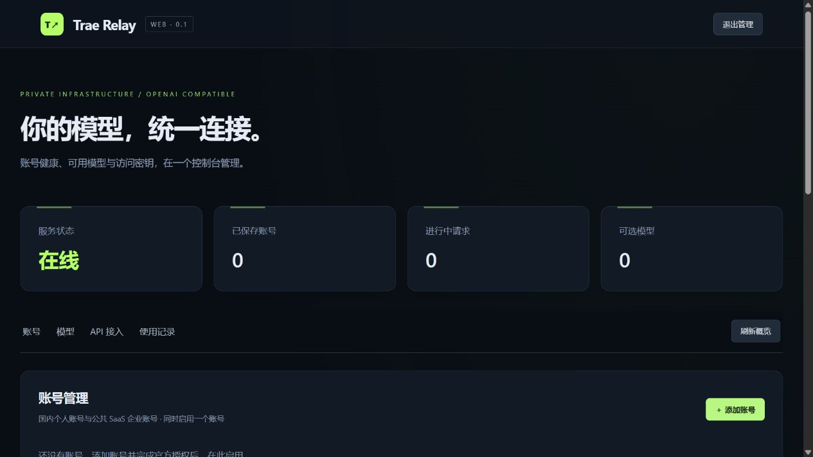

# 验证记录

日期：2026-11-05（Asia/Singapore）。原项目仅只读参考；实现与工具链均放在独立目录。

## 实际执行结果

| 项目 | 结果 |
| --- | --- |
| Go 工具链 | 官方 Go 1.25.3 windows/amd64，独立下载到工作目录 |
| `gofmt` | 已格式化全部 Go 文件 |
| `go vet ./...` | 通过 |
| `go test -race -v ./...` | **14 项全部通过，无数据竞争报告**，使用本机临时 HTTP 夹具 |
| Windows 构建 | `CGO_ENABLED=0 go build -trimpath` 通过 |
| Linux amd64 交叉编译 | `CGO_ENABLED=0 GOOS=linux GOARCH=amd64 go build -trimpath` 通过 |
| 前端 JavaScript | `node --check web/app.js` 通过 |
| 浏览器实测 | 本机无凭据实例：页面加载、管理密码登录、概览空状态正常；已截图 |
| Docker | PATH 和常见安装路径未发现 Docker，**未执行镜像构建和容器运行** |
| 真实 Trae 账号 | **未登录、未读取宿主凭据、未发起消耗额度请求** |

第一次沙箱执行时，沙箱临时目录替换文件和本机 TCP 连接受到限制。后续使用独立 `work/tmp` 并获准执行本机网络测试，完整测试通过。测试仅访问 `httptest` 的 localhost 服务；生产代码始终使用固定官方域名，测试专用传输层重写不会用于生产。

## 14 项测试

1. `TestEncryptedPersistence`：AES-GCM 加密恢复、无明文凭据、错误密钥和篡改拒绝。
2. `TestAuthSeparationAndCSRF`：API / 管理隔离、Cookie 属性、Origin 拒绝、密钥轮换、X-API-Key。
3. `TestSSEParsing`：CRLF、多行 data、注释与事件分发。
4. `TestNativeProtocolAndSSE`：真实上游请求体与鉴权头、JSON 字符串工具 schema、重复正文增量、reasoning、工具参数拼接、JSON/SSE 完成。
5. `TestPrematureEOFIsFailure`：缺少 done 时 JSON 502、流式错误，不能伪造完成。
6. `TestResponsesPreviousAndLifecycle`：previous_response_id 历史拼接与 Responses SSE 生命周期。
7. `TestCancellationAndConcurrency`：超并发即时拒绝、客户端取消上游、释放槽位。
8. `TestPKCEDeviceSignatureAndCallbackBinding`：S256、SPKI、公私钥配对、ECDSA ASN.1 签名和回调地址绑定。
9. `TestModelCatalogAndMultimodalTools`：模型档案合并、内部/隐藏过滤、Max、思考档位、工具图片顺序与协议标签消毒。
10. `TestStopAcrossUnicodeChunks`：跨片段中文 stop 截断及未命中尾部冲刷。
11. `TestResponseCustomNamespaceTools`：命名空间自定义工具包装和输出恢复。
12. `TestPersonalCallbackExchangeAndLegacyRefresh`：个人授权码交换、官方身份校验、旧刷新路径、禁止授权重放。
13. `TestEnterpriseCallbackTrustedIdentity`：企业刷新、可信主机/trace 校验、企业身份、拒绝保存服务端 Password。
14. `TestCacheUsageAttribution`：按 session 和 Token 总量一致性安全回填缓存用量。

## 无凭据可执行文件 smoke test

构建产物监听独立的 `127.0.0.1:18317`，使用临时测试管理密码和随机主密钥，未关联真实账号。

| 检查 | 实际结果 |
| --- | --- |
| GET `/health` | 200 |
| 未认证 GET `/v1/status` | 401 |
| 未认证 GET `/admin/state` | 401 |
| 管理登录与 GET `/admin/state` | 200，账号和模型均为 0 |
| API Key 轮换 | 成功，返回一次性新 Key |
| 无账号 GET `/v1/models` | 503 |
| 无账号 POST `/v1/chat/completions` | 503 |
| 无账号 POST `/v1/responses` | 503 |
| GET `/` | 200，含 CSP |
| `relay healthcheck` | exit 0 |
| 重启后使用已轮换 API Key GET `/v1/status` | 200，加密数据恢复成功 |

终端测试进程在验证后停止。浏览器截图仅含无凭据管理概览，无上游 token。

## 尚未验证

- 官方网页是否在浏览器本机无回调监听器时，仍留下完整可粘贴授权 URL；个人和 SaaS 的实际网页登录。
- 真实账号的设备注册、令牌刷新、当前 IDE 版本头、模型目录权限与实际模型生成。
- 图片、工具、Max、reasoning 和账单用量在当前真实上游的兼容性。
- Docker 镜像拉取/构建、Linux 容器启动和镜像中非 root volume 权限。WSL 原生 Linux 进程的健康检查和 SIGTERM 行为已验证，见下方补充记录。
- HTTPS 反向代理、Secure Cookie 和外网 SSE 传输。

以上边界没有用模拟成功代替，也没有声称已通过线上验证。README 给出部署、远程粘贴回调流程和已知功能差异。

## WSL 补充验证

2026-11-05，按用户要求在已运行的 WSL2 Ubuntu 24.04.5 LTS（x86_64，内核 6.6.87.2）验证。未安装系统包、未使用 sudo、未修改系统配置、用户配置或现有 Go；未启动或停止发行版，未启动 Docker 守护进程。

现有 `/usr/local/go/bin/go` 报告 Go 1.26.4，但编译标准库 runtime 时发生 mallocHeaderSize、heapBitsInSpan 等重复定义，疑似已有工具链混装。该工具链未修复、覆盖或删除。独立测试缓存、临时目录、数据和另行下载的官方 Go 均置于本项目 `work/wsl`，只对测试子进程设置环境变量。

使用项目目录内的官方 **Go 1.25.3 linux/amd64** 完成：

- `go test -race -v ./...`：14 项全部通过，无数据竞争报告。
- `go vet ./...`：通过。
- `CGO_ENABLED=0 go build -trimpath`：WSL 原生构建通过。
- 对该 WSL 原生构建再次执行完整 smoke test：全部通过，验证脚本最终退出码为 0。

原始记录：[WSL 测试日志](docs/wsl-tests.log)、[WSL smoke 结果](docs/wsl-smoke-results.json)。

原先交叉编译的 Linux 二进制已在 WSL 实际运行，下列检查全部通过：

| 检查 | 实际结果 |
| --- | --- |
| 健康检查 | 200，CLI healthcheck exit 0 |
| 未认证 API / 管理访问 | 401 |
| 管理登录、空账号/模型概览、API Key 轮换 | 通过 |
| 无账号模型、Chat、Responses | 均为 503 |
| 内嵌 Web 页面 | 200 |
| SIGTERM 正常退出 | exit 0 |
| 重启后的加密 API Key 恢复 | 200 |
| 状态文件不含明文 API Key / 管理密码 | 通过 |
| 重启实例再次 SIGTERM | exit 0 |

测试只监听临时分配的 `127.0.0.1` 端口，测试进程均已退出。Ubuntu 未发现 Docker / Podman 命令、Docker socket 或 Docker Desktop WSL 挂载；遵照不改变用户环境的要求，没有安装或配置容器运行时，因此仍不能声称 Docker 镜像实测通过。

## 内网部署配置修订验证

后续修订将 Compose 宿主映射改为 `0.0.0.0:8317:8317`，明确配置容器监听 `0.0.0.0:8317`；取消 Compose 变量模板，通过 `.env` 仅要求管理密码和加密主密钥。README 按内网部署重写，原仓库在 README 和管理页注明，新增首次配置生成脚本。

- 使用 WSL 已有 PyYAML 解析 Compose，校验固定宿主映射、容器监听和 `.env` 加载配置，通过；这不是 Docker Compose 实际运行验证。
- `sh -n scripts/init-env.sh` 通过；在项目临时目录执行，确认生成的主密钥解码后为 32 字节、管理密码符合长度要求、配置仅含两项。
- 重复运行脚本返回非零，已有 `.env` 内容保持不变。
- WSL `go test ./...` 的 14 项现有测试及 Linux 原生构建通过。
- 清除测试子进程的 `RELAY_LISTEN`，确认程序默认通配监听；Linux 可能以双栈 socket 表示。通过 WSL 实际非回环 IPv4 地址访问 `/health`，返回 200。
- 内嵌页面包含原仓库链接；测试进程 SIGTERM 退出码为 0，已停止。

测试缓存、配置和数据均位于本项目 `work` 下，没有修改系统配置或使用真实账号。Docker 容器运行的验证边界保持不变。

## 账号诊断、多密钥、余额与 UI 更新

新增 4 项离线测试，当次完整套件为 **18 项**；WSL `go test -race -v ./...` 全部通过、无数据竞争报告，Windows `go vet`、Windows/Linux 原生构建及 JavaScript 语法检查通过。

- `TestMultipleKeysMigrationAndRevocation`：新增密钥与旧密钥并存、独立启停/重命名/撤销、加密重启恢复、列表不返回完整密钥、API 与管理权限隔离。
- `TestPersonalBalanceAndMetadataCheck`：验证官方身份和两类目录，不访问生成接口；个人 `ide_user_ent_usage` 请求和权威积分口径；诊断与余额持久化。
- `TestBalanceParsingAndFailures`：积分字段回退、0 余额、过期权益包过滤、非有限值拒绝、401 和未知账号错误。
- `TestEnterpriseQuotaIsNotRemainingBalance`：官方身份验证、企业套餐额度读取，保持剩余额度未知，不将套餐总额冒充余额。

实际浏览器使用本机无账号临时实例验收了管理登录、新概览和密钥列表，见 [界面](docs/management.png) 与 [密钥管理](docs/keys.png)。账号卡片上的诊断和余额功能使用离线 HTTP 夹具验证，没有使用真实账号或消耗额度。

新数据兼容旧加密状态，原 API Key 保留可用。余额手动查询，不自动产生后台查询；企业金额计费不可用时展示官方控制台入口。真实账号与 Docker 的未验证边界保持不变。

## 管理密码长度要求移除验证

管理页登录密码不再要求最少 16 字符：`newApp` 只拒绝空密码，其他长度均可启动并登录；`scripts/init-env.sh` 仍生成 32 字节随机密码。

- `TestAdminPasswordOnlyRequiresNonEmpty`：单字符密码启动并登录成功，错误密码返回 401，空密码拒绝启动。
- `go vet ./...` 通过；`go test -race ./...` **19 项全部通过，无数据竞争报告**。
- Docker 容器运行与真实 Trae 账号的未验证边界保持不变。

## 上游错误语义与重试补全验证

生成失败不再统一折叠为 `502 upstream_request_failed`：`upstreamFailure` 按上游状态与错误码映射为 401 / 403 / 429 / 400 / 502，响应保留脱敏 `code` 与上游 `message`，并写一行不含凭据的运行日志。流内 `error` 事件 code 1001 与 HTTP 401 一样刷新凭据后重试一次，仅在尚未向客户端发出事件时重试；新增首事件超时（`RELAY_FIRST_EVENT_TIMEOUT_SEC`，默认 120 秒），超时报 `upstream_first_event_timeout`。

新增 4 项离线测试，当次完整套件为 **23 项**，`go test -race ./...` 全部通过且无数据竞争报告；`gofmt -l .` 无输出、`go vet ./...` 通过、原生构建通过。

- `TestUpstreamErrorsKeepStatusAndMessage`：code 4011 → 429 `rate_limit_error`、1005 → 403 `insufficient_quota`、4001 → 400 `invalid_request_error`，非流式与流式请求状态一致，错误帧带上游 message，且不输出 `[DONE]`。
- `TestExpiredTokenMapsTo401`：HTTP 401 且刷新失败时返回 `401 authentication_error`，message 为上游原文。
- `TestStreamAuthErrorRefreshesOnce`：流内 code 1001 触发刷新并重试一次，第二次请求使用新 token 成功，新 token 落盘。
- `TestFirstEventTimeoutIsReported`：上游 100 毫秒内无事件时返回 `502 upstream_first_event_timeout`。

## 多账号池验证

启用多个账号时不再只用第一个账号：`pick` 按轮询（或 `RELAY_ACCOUNT_SELECT=credits` 时按最近余额降序）选择可用账号，每个账号受 `RELAY_MAX_CONCURRENT` 限制，全部占满或仍在 `RELAY_ACCOUNT_MIN_INTERVAL_MS` 间隔内时最多排队 `RELAY_ACCOUNT_QUEUE_MS`（默认 30 秒），超时返回 `503 account_concurrency_limit`，无启用账号返回 `503 no_enabled_account`。`/v1/models` 合并所有启用账号目录，后台目录刷新也遍历全部启用账号。

新增 3 项离线测试，当次完整套件为 **26 项**，`go test -race ./...` 全部通过且无数据竞争报告；`gofmt -l .` 无输出、`go vet ./...` 与原生构建通过。

- `TestPoolRoundRobinAndQueue`：两个账号轮流选中；都占满时等待约 50 毫秒才报 busy；释放后立即可用；排除名单生效。
- `TestPoolCreditOrderAndMinInterval`：余额 900 / 10 / 未知按降序选中；最小间隔内第二轮换到另一账号。
- `TestModelsMergeAcrossAccounts`：`/v1/models` 同时返回两个账号各自独有的模型。

未验证边界：真实多账号的上游并发与限流表现未实测（本地实例只有一个 Trae 账号），排队与选择逻辑仅由离线夹具覆盖。

## 上游 User-Agent 修复

Go 默认的 `User-Agent: Go-http-client/1.1` 会被上游当作非客户端流量，返回 SSE `event:error {"code":4011,"message":"...exceeded the rate limit..."}`；同一 token、同一请求体、同一组 IDE 头下改成 `Trae/3.4.0` 即可正常生成，`curl/8.5.0`、`Python-urllib/3.11`、`Go-http-client/2.0` 均被同样拒绝。修复为所有上游请求发送 `User-Agent: Trae/<IDE 版本>`。

新增测试 `TestUpstreamRequestIdentifiesDesktopClient` 断言上游收到该 UA，当次完整套件 27 项、`go test -race` 通过。

真机验证：容器重建后 10.45:8317 对 `deepseek-v4.1-flash` 的流式与非流式请求均返回 200 与真实内容（此前稳定 `429 upstream_rate_limited`）。

## 每日签到

个人账号每日签到的请求序列、多键状态判定、稳定设备标识与重试策略均按参考实现迁移：

- 稳定设备标识：`sha256("TraeRelay-checkin-probe:" + userId)` 前 8 字节大端转整数，映射为 `100000000000000 + v % 900000000000000`，只用于签到请求的 `x-device-id`，不改变网页登录的设备身份。
- 状态判定支持 `checked_in` / `did_checked_in` / `already_checked_in` / `checkin_status` 等多种上游写法，`checked_in` 优先，避免 `did_checked_in=false` 覆盖已签到；上游 `code` 深层搜索，`9095` 视为账号级拒绝。
- 领取后用 `pay/ide_user_ent_usage` 的账户总额前后对比确认入账，再刷新积分；claim 失败时先复查 status，确认已签到才记为待确认，不重放 claim。
- 同一天内成功、已签到、账号拒绝、待确认都不再重复领取；失败则 15 分钟后重试；跨天重新执行。

新增 6 项离线测试（稳定标识向量、状态解析、领取并确认、claim 失败不重放、签到使用稳定设备标识、due 规则），完整套件 **33 项**，`go test -race ./...` 通过，`gofmt`/`go vet` 干净。

未验证：真实上游签到成功路径未在本次改动中实测（需要真实账号当日未签到）。
